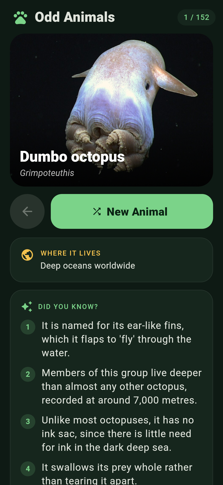
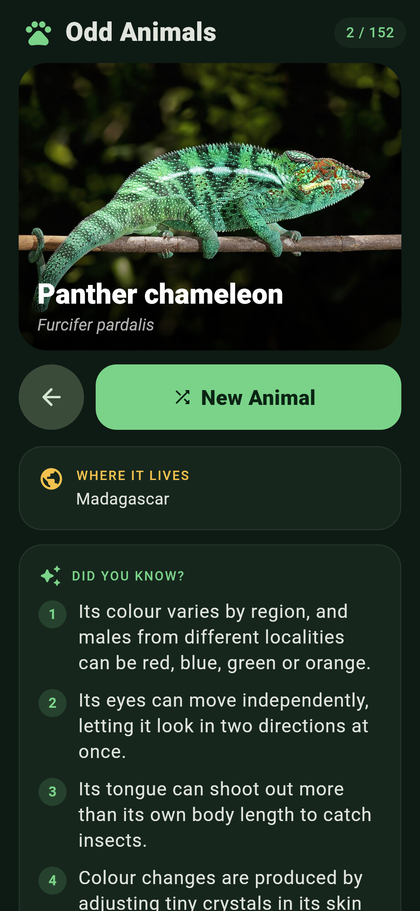

# Odd Animals 🐾

An Android app that shows you a random **little-known animal** with a photo and some interesting facts about it. Tap **New Animal** to get another one.

<p>
  
  
</p>

## Features
- **152 obscure animals**, including the aye-aye, olm, saiga, blobfish, shoebill, pangolins, tardigrades and the dumbo octopus.
- Each card shows the common name, scientific name, where it lives, and 3–5 facts.
- A **New Animal** button right under the photo. The app uses a shuffle-bag, so you see every animal once before any repeats. Your progress is saved between launches, and the back arrow returns you to the previous animal.
- Photos and a short summary load live from Wikipedia/Wikimedia Commons, with a "Read more" link to the full article.
- A dark, nature-themed design with rounded cards.
- If you're offline, the app shows a placeholder in place of the photo. The facts are bundled with the app, so they always work.

## Install
Download `OddAnimals-v1.0.apk` from the [latest release](../../releases/latest) and open it on your Android phone. You'll need to allow "Install unknown apps" for your browser or file manager. Requires Android 7.0 or later.

## Build from source
Requires Flutter 3.35 or later.
```bash
flutter pub get
flutter test
flutter build apk --release
```
For release signing, create `android/key.properties` (it is gitignored) with `storeFile`, `storePassword`, `keyAlias` and `keyPassword`. Without that file, release builds fall back to the debug key.

### Animal data
The animal data lives in `tool/data/*.txt`, one animal per line: `Name|Scientific name|Wikipedia title|Habitat|fact;;fact;;...`.
`python3 tool/build_data.py` checks every Wikipedia title against the API, resolves the photo URLs and regenerates `assets/animals.json`.

## Credits
Photos come from Wikimedia Commons, and summaries come from Wikipedia (CC BY-SA). Each image's author and license are listed on its Commons page.
